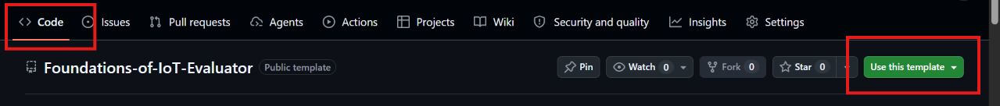
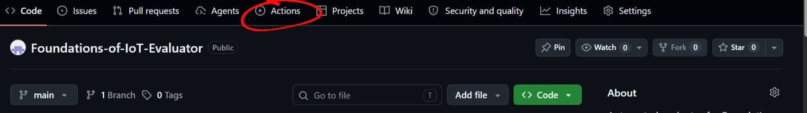
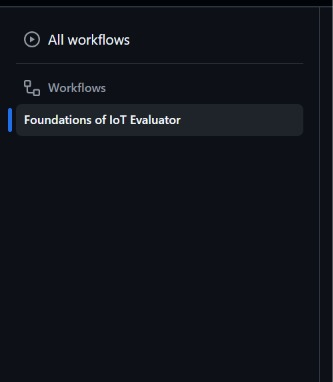
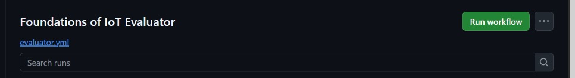
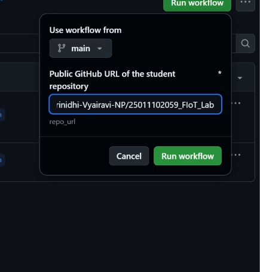
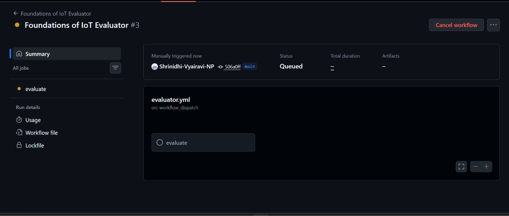
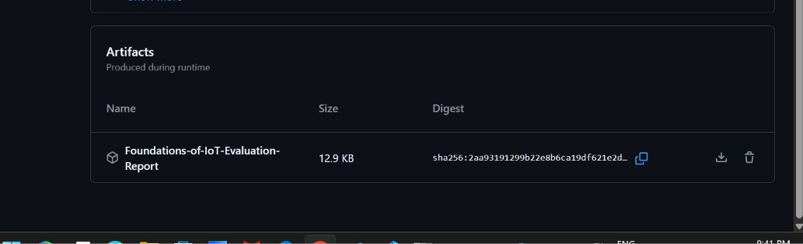

# Foundations of IoT – Automated Repository Evaluation

This guide explains how to set up your own copy of the Foundations of IoT Evaluator using this template repository, evaluate your GitHub repository, and download your evaluation report.

## 1. Before You Begin

Make sure that:

- You have uploaded your Foundations of IoT experiments to GitHub.
- Your repository follows the prescribed folder structure.
- Your lab repository is set to **Public**.
- You have copied your GitHub lab repository URL.

Example repository URL:

`https://github.com/your-username/25011102059_FIoT_Lab`

**Important:** Private repositories cannot currently be evaluated because the evaluator does not use GitHub authentication.

## 2. Create Your Own Evaluator Copy (Use This Template)

Because GitHub Actions workflows can only be triggered by repository owners, you must first create your own copy of this evaluator repository:

1. Make sure you are logged into your GitHub account.
2. On this evaluator repository page, make sure you are on the **Code** tab (top-left).
3. Click the green **Use this template** button near the top-right and select **Create a new repository**.

4. Enter a repository name (for example, `FIoT-Evaluator`).
5. Set the visibility to **Public** or **Private** (either works for your evaluator copy).
6. Click **Create repository**.

GitHub will redirect you to your newly created evaluator repository.

## 3. Enable Actions and Open the Evaluation Workflow

1. Inside **your newly created evaluator repository**, click the **Actions** tab at the top.

2. If GitHub displays a notice asking to enable workflows, click the green **"I understand my workflows, go ahead and enable them"** button.
3. On the left-hand sidebar, find and click the workflow named:

   **Foundations of IoT Evaluator**

4. You should now see a **Run workflow** button on the right-hand side.

## 4. Run the Evaluation

1. Click **Run workflow**.
2. A dropdown will appear containing an input field named:

   `Public GitHub URL of the student repository`

3. Paste your **lab repository URL** (not the evaluator URL) into this field.

   Example:

   `https://github.com/your-username/25011102059_FIoT_Lab`

4. Make sure the URL is correct.
5. Click the green **Run workflow** button.

Your evaluation will now begin.

## 5. Wait for the Evaluation to Complete

1. GitHub will create a new workflow run (you may need to refresh the page after a few seconds).
2. Click the running workflow to view its progress.
3. Wait until the workflow finishes.

The status indicators mean:

- **Yellow:** Evaluation is in progress.
- **Green:** Workflow completed successfully.
- **Red:** Workflow encountered an error.

**Note:** A green workflow status means the evaluation process completed successfully. It does not necessarily mean that your repository passed all evaluation checks.

## 6. Download Your Evaluation Report

After the workflow finishes:

1. Open the completed workflow run.
2. Go inside **Summary**.
3. Scroll down to the **Artifacts** section.

4. Find the artifact named:

   `Foundations-of-IoT-Evaluation-Report`

5. Click the artifact name to download it.
6. GitHub will download a ZIP file.
7. Extract the ZIP file on your computer.

You will find both the Markdown (`evaluation_report.md`) and PDF (`evaluation_report.pdf`) evaluation reports inside.

## 7. Understand Your Evaluation Report

The report contains:

- Number of experiments discovered.
- Number of experiments passed and failed.
- File and folder checks.
- Missing or incorrect files.
- README availability and contents.
- Overall evaluation status.

Check the failed items carefully and correct any issues in your lab repository if permitted by your course instructions.

## 8. Troubleshooting

| Problem | What to check |
|---|---|
| **Run workflow** button is missing | Make sure you created your own repository using **Use this template** and are viewing your copy, not the original template repo. |
| Workflows do not appear in Actions | Click **"I understand my workflows, go ahead and enable them"** in the **Actions** tab of your new repository. |
| Workflow does not start | Make sure you clicked the green **Run workflow** button inside the dropdown. |
| Invalid repository URL | Check that you pasted the complete GitHub HTTPS URL of your lab repository. |
| Repository download fails | Make sure your lab repository is set to **Public**. |
| No experiments discovered | Check your `8051` and `STM32` folder structure. |
| Missing file errors | Verify that all required files have been uploaded. |
| Artifact not available | Wait for the workflow to finish completely and refresh the Summary page, or inspect the logs to see if the script failed. |

If the workflow fails, open the workflow run and inspect the failed step to identify the error.

## 9. Important Instructions

- Use your own **lab** GitHub repository URL as the workflow input.
- Make sure your lab repository is **Public**.
- Do not modify the evaluator scripts or workflow files in your template copy.
- Do not submit someone else's repository URL.
- Download and inspect your evaluation report after every evaluation.
- A successful workflow execution does not guarantee that all evaluation requirements have passed.

**Ensure that your lab repository is complete and accessible before submitting its GitHub URL through the designated submission channel.**